# Dashboard de demanda en delivery: SQL (DuckDB) + Power BI + Looker Studio

[](https://github.com/s7ex-j/dashboard-demanda-delivery/actions/workflows/ci.yml)
[](LICENSE)
[](https://doi.org/10.5281/zenodo.23753183)

Capa de datos y dashboard para el dataset público *Food Demand Forecasting* (Genpact / Analytics
Vidhya, Kaggle): **456 548 registros** semana × centro × comida, 145 semanas, 77 centros y 51
comidas.

Es la segunda parte de mi
[estudio de elasticidad precio-demanda](https://github.com/s7ex-j/demanda-delivery-v2). El
estudio estima modelos econométricos; este repositorio convierte los mismos datos en un modelo
dimensional, consultas de negocio probadas y un dashboard.

## Qué muestra este proyecto

- **Modelado dimensional:** esquema estrella con una tabla de hechos y tres dimensiones.
- **SQL analítico** en DuckDB: CTE, funciones de ventana (`LAG`, medias móviles, `RANK`,
  `DENSE_RANK`, `NTILE`, sumas acumuladas), análisis ABC (Pareto) y cohortes con control de
  censura.
- **Calidad de datos:** 17 reglas que detienen el pipeline si algo falla, y tests que comprueban
  que cada regla detecta su error.
- **Tests de lógica:** cada consulta se recalcula en pandas y se compara con el SQL.
- **Conciliación:** con los datos reales, los resultados coinciden con las tablas publicadas
  por el estudio v3.3.0.
- **BI:** dashboard en Power BI (modelo estrella y medidas DAX) y versión pública en Looker
  Studio.

## Arquitectura

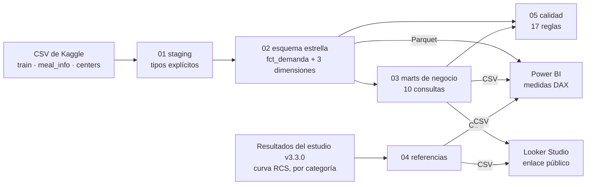

```
fct_demanda (456 548 filas)          dim_comida   meal_id, categoria, cocina
  semana ──────────► dim_semana       dim_centro   center_id, tipo, región, ciudad, área
  center_id ───────► dim_centro       dim_semana   semana, año relativo, trimestre
  meal_id ─────────► dim_comida
  pedidos, precios, promociones, ingreso_estimado
```

## Consultas de negocio

| Mart | Pregunta |
|---|---|
| `mart_kpis` | ¿Qué tamaño tiene el negocio en el periodo? |
| `mart_tendencia_semanal` | ¿Cómo evoluciona la demanda semana a semana y frente a hace 52 semanas? |
| `mart_categorias` | ¿Qué categorías concentran la demanda? |
| `mart_comidas_abc` | ¿Qué comidas sostienen el negocio (clasificación ABC)? |
| `mart_promociones_matriz` | ¿Cuántos pedidos tiene una fila según el tipo de promoción? |
| `mart_promociones_indice` | ¿Cuánto vende una comida con promoción frente a ella misma sin promoción, en el mismo centro? |
| `mart_centros` | ¿Qué centros venden más, en total y dentro de su tipo? |
| `mart_tipos_centro` | ¿Cómo se comparan los tipos de centro? |
| `mart_cohortes` | Cuando un centro empieza a vender una comida, ¿la sigue vendiendo? |
| `mart_bandas_precio` | ¿Cómo cambia el volumen según el decil de precio? |

El detalle de cada una (técnica y qué no se puede concluir) está en
[`docs/consultas.md`](docs/consultas.md).

## Dashboards

### Power BI

Proyecto **PBIP** en [`dashboard/powerbi/`](dashboard/powerbi/): modelo estrella, medidas DAX
([`medidas.dax`](dashboard/powerbi/medidas.dax)) y cinco páginas. También en
[PDF](docs/dashboard_demanda.pdf).

**1. Describir:** KPIs, pedidos por semana con media móvil, categorías, tipos de centro y promociones.
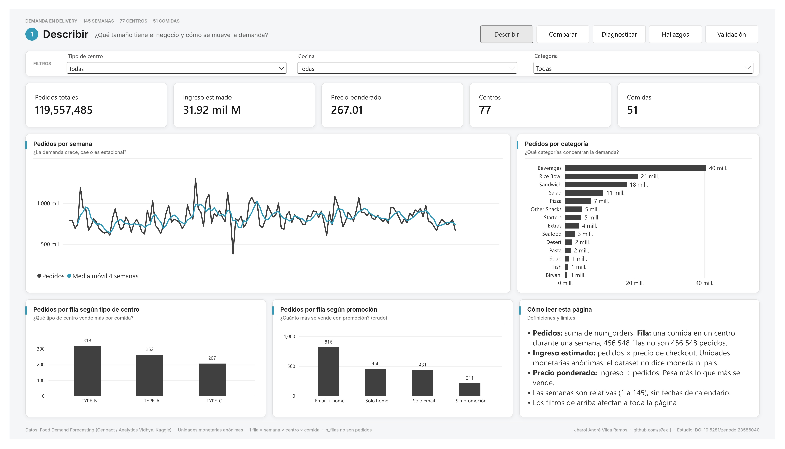

**2. Comparar:** participación por categoría, clasificación ABC de comidas, años relativos y ranking de centros.
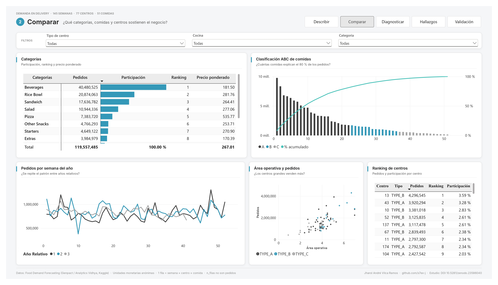

**3. Diagnosticar:** índice de promociones controlado por centro y comida, permanencia por cohortes, deciles de precio y elasticidades del estudio (descriptivas).
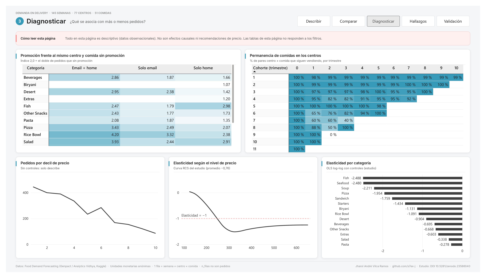

**4. Hallazgos y límites:** qué muestran los datos, qué no se puede concluir y cómo se construyó.
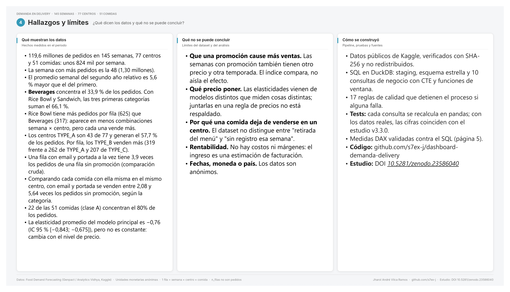

**5. Validación:** controles de totales, las 17 reglas de calidad y el mismo total calculado en SQL y en DAX.
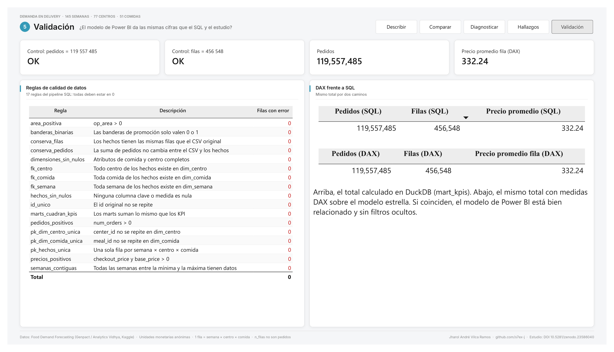

> **Para abrirlo en otro equipo:** corre `python -m pipeline.build` y, en Power BI Desktop,
> actualiza la ruta de los orígenes de datos (*Transformar datos → Configuración de origen de
> datos → Cambiar origen*). El modelo apunta a la carpeta `exportes/` de la máquina donde se creó.

### Looker Studio

Versión pública, sin instalar nada:
**[abrir el informe en Looker Studio](https://lookerstudio.google.com/reporting/26c68f6d-8127-45d0-81d8-99ef04342e32)**.
También en [PDF](docs/looker_demanda.pdf). Usa solo tablas agregadas
([`dashboard/looker/datos/`](dashboard/looker/datos/)), no el detalle de Kaggle.

**1. Describir:** KPIs, pedidos por semana con media móvil, categorías, tipos de centro y promociones.
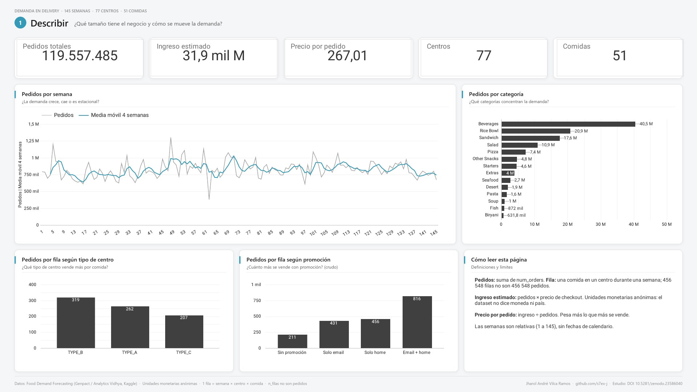

**2. Comparar:** participación por categoría, clasificación ABC de comidas, semanas por año relativo, área operativa frente a pedidos y ranking de centros.
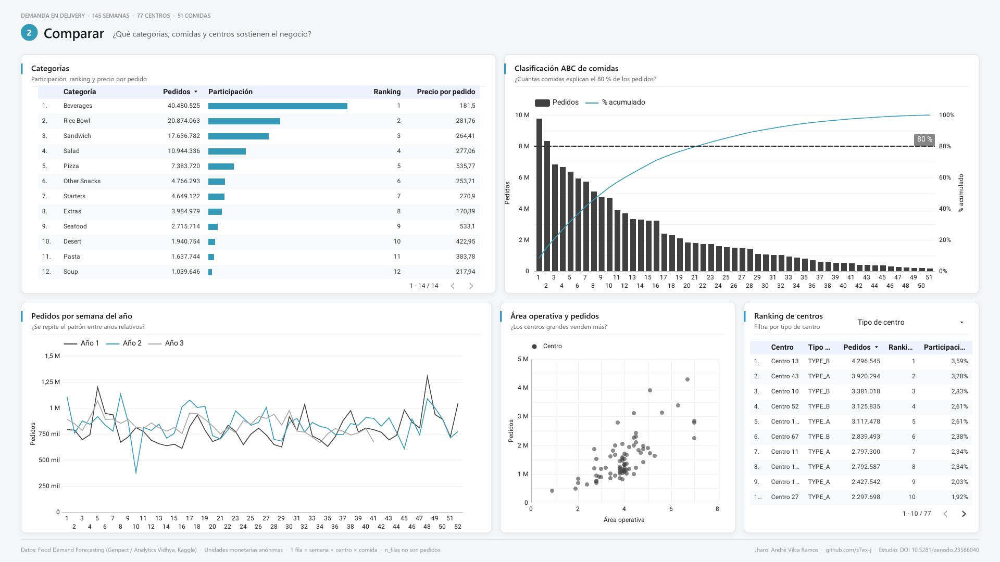

**3. Diagnosticar:** índice de promociones controlado por centro y comida, permanencia por cohortes, deciles de precio y elasticidades del estudio (descriptivas).
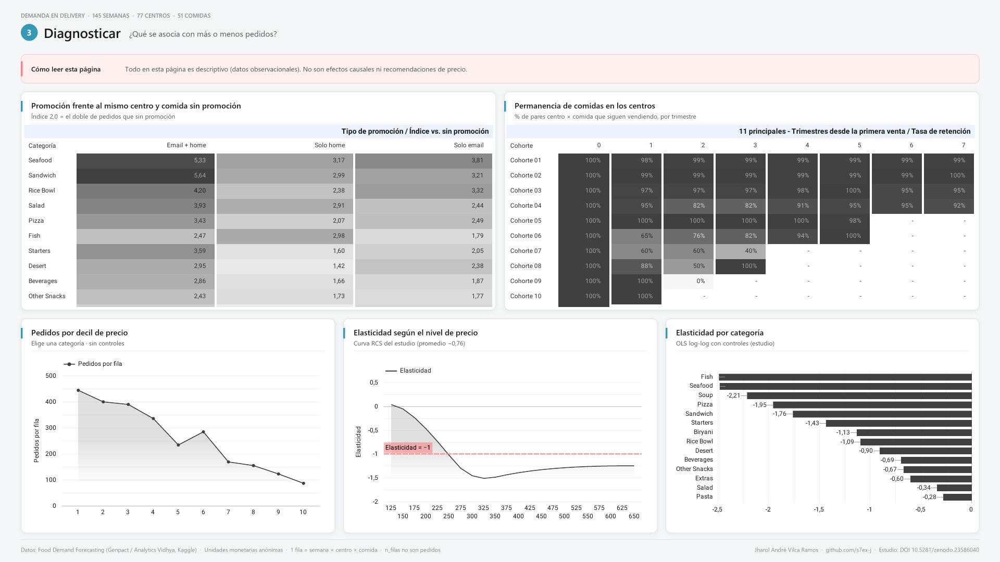

**4. Hallazgos y límites:** qué muestran los datos, qué no se puede concluir y cómo se construyó.
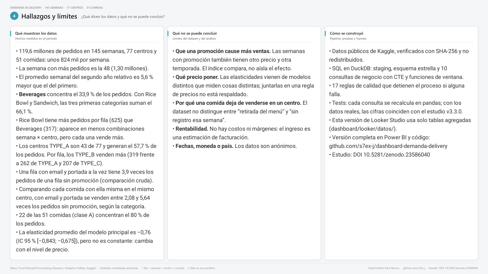

**5. Validación:** totales, las 17 reglas de calidad y el cuadre con el estudio v3.3.0.
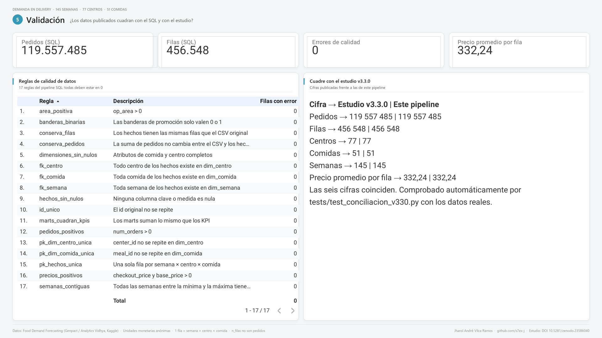

## Cómo reproducirlo

Requisitos: Python 3.10 o superior. En Windows (`cmd`):

```
git clone https://github.com/s7ex-j/dashboard-demanda-delivery.git
cd dashboard-demanda-delivery
python -m venv .venv
.venv\Scripts\activate
pip install -r requirements.txt
```

1. Copia los tres CSV de Kaggle en `data/raw/` (los datos no se redistribuyen; ver
   [`data/raw/README.md`](data/raw/README.md)).
2. Construye la base, valida la calidad y exporta:
   ```
   python -m pipeline.build
   ```
   Crea `salida/demanda.duckdb`, `exportes/estrella/*.parquet` y `exportes/marts/*.csv`.
3. Corre los tests:
   ```
   python -m pytest -v
   ```
   Sin datos reales, los tests de conciliación se omiten y el resto corre sobre un dataset
   sintético pequeño ([`tests/fixtures/`](tests/fixtures/)). Así funciona también GitHub
   Actions, en Ubuntu y Windows.

Para explorar la base: `duckdb salida/demanda.duckdb` (CLI de DuckDB) o cualquier cliente SQL
con soporte para DuckDB, como DBeaver.

## Tests

| Archivo | Qué comprueba |
|---|---|
| `tests/test_calidad.py` | Las 17 reglas pasan con datos limpios. Con 11 errores inyectados (duplicados, claves huérfanas, semanas faltantes, nulos, valores fuera de rango), cada regla los detecta y el pipeline se detiene |
| `tests/test_marts.py` | Cada mart recalculado en pandas, sin SQL, da lo mismo que DuckDB |
| `tests/test_exportacion.py` | Parquet y CSV completos y legibles |
| `tests/test_conciliacion_v330.py` | Con los datos reales: el SHA-256 de `train.csv` y los KPI, categorías, promociones, tipos de centro y tendencia coinciden con el estudio v3.3.0 |

## Relación con el estudio de elasticidad

| | |
|---|---|
| Repositorio del estudio | <https://github.com/s7ex-j/demanda-delivery-v2> |
| Informe (working paper) | [10.5281/zenodo.23586040](https://doi.org/10.5281/zenodo.23586040) |
| Código del estudio | [10.5281/zenodo.23585772](https://doi.org/10.5281/zenodo.23585772) |

Este repositorio no vuelve a estimar modelos. La página de precio del dashboard muestra la curva
de elasticidad RCS y las elasticidades por categoría tal como las publicó el estudio, marcadas
como **descriptivas**. La elasticidad promedio del modelo principal es **−0,76** (OLS log-log
con controles; IC 95 % [−0,843; −0,675]). El estudio muestra que la elasticidad no es constante,
así que el dashboard no da recomendaciones de precio
([por qué](docs/consultas.md#por-qué-el-dashboard-no-da-recomendaciones-de-precio)).

## Uso de IA

Usé Claude (Anthropic) como asistente para redactar SQL, tests y documentación. Revisé el
código, ejecuté los tests y comprobé los resultados contra el estudio publicado. Las decisiones
de diseño y de alcance, y los errores que queden, son míos.

## Cómo citar

Vilca Ramos, J. A. (2026). *Dashboard de demanda en delivery: SQL (DuckDB), Power BI y Looker
Studio* (v1.0.0) [Software]. Zenodo. <https://doi.org/10.5281/zenodo.23753183>

El DOI apunta siempre a la última versión; la v1.0.0 tiene su propio DOI,
[10.5281/zenodo.23753184](https://doi.org/10.5281/zenodo.23753184). Los metadatos están en
[`CITATION.cff`](CITATION.cff) (GitHub muestra el botón *Cite this repository*).

## Autor

Jharol André Vilca Ramos · [ORCID 0009-0009-7897-3439](https://orcid.org/0009-0009-7897-3439) ·
[GitHub](https://github.com/s7ex-j)

Código bajo licencia [MIT](LICENSE). Los datos pertenecen a sus autores y no se incluyen.
